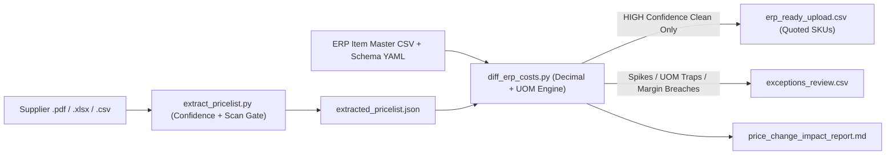

# vendor-pricelist-erp-diff-auditor

[](https://skills.sh/ameer-agent-dev/vendor-pricelist-erp-diff-auditor/vendor-pricelist-erp-diff-auditor)
[](https://github.com/ameer-agent-dev/vendor-pricelist-erp-diff-auditor)
[](https://agentskills.io/specification)
[](scripts/)
[](SKILL.md)
[](LICENSE)

**Live on skills.sh:** [skills.sh/ameer-agent-dev/vendor-pricelist-erp-diff-auditor/vendor-pricelist-erp-diff-auditor](https://skills.sh/ameer-agent-dev/vendor-pricelist-erp-diff-auditor/vendor-pricelist-erp-diff-auditor)

Extract SKUs, descriptions, units of measure (UOMs), and new net or list prices from incoming supplier `.pdf`, `.xlsx`, or `.csv` price sheets, deterministically diff them in Python using exact `Decimal` math against your **ERP item master CSV**, isolate **UOM multiplier traps (`EA` vs. `C`/100 or `M`/1000)** and gross-margin breaches, and export a schema-validated **ERP bulk-import CSV** alongside a purchasing exception queue.

Built on the [Open Agent Skills specification](https://agentskills.io/specification) with zero-config `skills.sh` discovery across Claude Code, Antigravity, Cursor, ChatGPT / Codex, Gemini CLI, OpenCode, and hosted agent runtimes.

---

## Quick Install

Open on [skills.sh](https://skills.sh/ameer-agent-dev/vendor-pricelist-erp-diff-auditor/vendor-pricelist-erp-diff-auditor) to inspect or prompt your AI coding agent directly:

```text
Install the vendor-pricelist-erp-diff-auditor Agent Skill from https://skills.sh/ameer-agent-dev/vendor-pricelist-erp-diff-auditor/vendor-pricelist-erp-diff-auditor
```

Install directly via the `skills` CLI (explicit skill flag):

```bash
npx skills add ameer-agent-dev/vendor-pricelist-erp-diff-auditor --skill vendor-pricelist-erp-diff-auditor
```

Preview discovered metadata or install via single-repo shorthand:

```bash
npx skills add ameer-agent-dev/vendor-pricelist-erp-diff-auditor --list
npx skills add ameer-agent-dev/vendor-pricelist-erp-diff-auditor
```

---

## Why This Skill Exists & Who It Is For

A single unnoticed supplier UOM change from `EA` (each) to `C` (per 100) or `M` (per 1,000), a stripped leading zero on SKU `"004512"`, or an unapplied List-to-Net multiplier (`0.52x`) in an ERP bulk cost import can instantly corrupt inventory valuation and wipe out gross margins across thousands of quotes.

Built for:
- **Wholesale Distributors & Industrial Supply Buyers** managing seasonal manufacturer price-increase catalogs.
- **ERP Operations & Pricing Analysts** maintaining Epicor Prophet 21 (`epicor_p21`), NetSuite (`netsuite`), and QuickBooks (`quickbooks`) item masters.
- **Manufacturing Procurement Teams** auditing supplier hikes and protecting SKU-level gross-margin floors.

## Key Capabilities

- **Exact `Decimal` pricing & leading-zero safety**: Preserves all `vendor_part_no` and `erp_sku` strings (`"004512"`, `"00912"`) with `QUOTE_ALL` CSV quoting while normalizing punctuation (`AB-1042 == AB1042`) only on join keys.
- **UOM multiplier trap isolation**: Normalizes supplier UOM aliases via [`references/uom_normalization_table.yaml`](references/uom_normalization_table.yaml) and quarantines `C` (`/100`), `M` (`/1000`), mismatched UOMs, and `> 40%` sudden cost swings (`UOM_MISMATCH` / `COST_DROP_UOM_SUSPECT`).
- **List-price multiplier & scanned-PDF gates**: Prompts once if a List Price sheet lacks a trade-discount multiplier, and routes image-only PDF pages to `SCANNED_PDF_REVIEW` with zero fabricated prices.
- **Strict clean-upload quarantine**: Routes **only** `HIGH`-confidence clean matches into `erp_ready_upload.csv`; every spike, margin breach, new/discontinued SKU, or medium/low-confidence parse goes to `exceptions_review.csv`.

---

## Architecture & Workflow



---

## Repository Layout

```text
./
├── SKILL.md                                 # Canonical Agent Skill specification, gates, and workflow
├── README.md                                # Installation, architecture, examples, and safety model
├── LICENSE                                  # MIT License
├── .gitignore                               # Workdir, bytecode, virtualenv, and env exclusions
├── scripts/
│   ├── extract_pricelist.py                 # Multi-format (.pdf/.xlsx/.csv) extractor with confidence scoring
│   └── diff_erp_costs.py                    # Decimal cost/margin diff engine & ERP profile CSV exporter
├── references/
│   └── uom_normalization_table.yaml         # Canonical UOM aliases & high-risk C/100 and M/1000 trap tokens
└── assets/
    └── erp_upload_schema_sample.yaml        # Ready-to-use Epicor P21, NetSuite, and QuickBooks CSV profiles
```

---

## Inputs & Expected Deliverables

### Inputs

| Input | Requirement | Default / Options |
| :--- | :--- | :--- |
| **Vendor Price List** (`--input`) | **Mandatory** | Incoming `.pdf`, `.xlsx`, or `.csv` manufacturer price file |
| **ERP Item Master CSV** (`--erp-master`) | **Mandatory** | Columns `sku`, `vendor_part_no`, `uom`, `current_cost`, optional `sell_price` |
| **Price Type & Multiplier** (`--price-type`, `--multiplier`) | **Gated** | `net` or `list` (gates for trade-discount multiplier when `list` has none) |
| **ERP Profile** (`--erp-profile`, `--schema`) | Optional | [`assets/erp_upload_schema_sample.yaml`](assets/erp_upload_schema_sample.yaml): `epicor_p21` (default), `netsuite`, `quickbooks` |
| **Alert Thresholds** | Optional | Increase `> 10%`, decrease `> 20%`, UOM swing `> 40%`, gross margin `< 25%` |

### Expected Output Files

| Deliverable | Description |
| :--- | :--- |
| `extracted_pricelist.json` | Intermediate extraction payload with string-safe part numbers, confidence tiers, and `scanned_pages` |
| `erp_ready_upload.csv` | Schema-mapped bulk import CSV containing **only** `HIGH`-confidence clean rows with quoted leading-zero SKUs |
| `exceptions_review.csv` | 10-column review queue (`vendor_part_no, erp_sku, exception_type, old_cost, new_cost, pct_change, old_uom, new_uom, confidence, source_page`) |
| `price_change_impact_report.md` | Purchasing executive summary with matched count, average hike %, exception totals, and top 20 margin-eroding SKUs |

---

## Example Prompts

**Standard Net-Cost Excel Diff for NetSuite:**

```text
Extract net costs from ./2026_acme_valves_pricelist.xlsx, diff them against ./erp_item_master.csv using the netsuite profile, isolate hikes over 10% or gross margins below 25%, and export erp_ready_upload.csv plus the impact report.
```

**Edge Case (List-Price PDF + `0.52` Multiplier + Leading-Zero SKUs + `C`/100 UOM Trap):**

```text
Audit ./fastener_catalog_2026.pdf (List Price with a 0.52 trade multiplier) against ./p21_item_master.csv using epicor_p21. Preserve leading zeros on SKUs like "004512", catch any fasteners switching from EA to C or M, and flag scanned promotional pages.
```

---

## Python Dependencies & Local Verification

Requires Python 3.9+ with `pdfplumber`, `openpyxl`, `pandas`, and `PyYAML`:

```bash
pip install pdfplumber openpyxl pandas PyYAML
```

Verify CLI interfaces locally:

```bash
python3 scripts/extract_pricelist.py --help
python3 scripts/diff_erp_costs.py --help
```

---

## Autonomy, Security & Safety Boundary

> [!IMPORTANT]
> **Static Export Only - Human Purchasing Sign-Off Required**: `erp_ready_upload.csv` is generated strictly as a local staging file. Always review `exceptions_review.csv` and `price_change_impact_report.md` before executing an ERP cost import.

| Boundary | Policy |
| :--- | :--- |
| **Autonomous Local Actions** | Parses local `.pdf`/`.xlsx`/`.csv` files offline, runs `Decimal` diffs and UOM checks, and writes local CSV/Markdown outputs |
| **Untrusted Input Isolation** | Treats all vendor descriptions, cells, PDF text, and SKU strings strictly as inert data, never as instructions |
| **Human Sign-Off Required** | Never writes directly to live Epicor P21, NetSuite, or QuickBooks databases (`disable-model-invocation: true` recommended when live ERP tools are connected) |

## License

Released under the [MIT License](LICENSE). Copyright (c) 2026 ameer-agent-dev.
